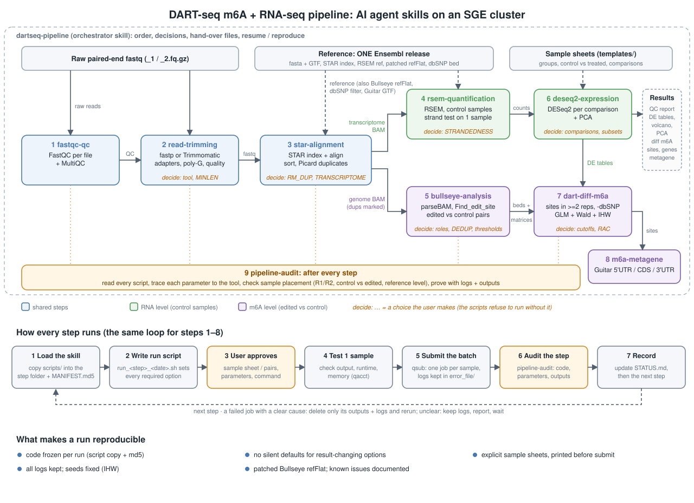

# agentic-rnaseq-m6a: a reproducible DART-seq m6A + RNA-seq pipeline as AI agent skills

This repository contains ten agent skills for AI coding agents. Together they run a DART-seq experiment (m6A sites detected through APOBEC1-YTH C-to-U editing) from raw paired-end fastq to:
- differential gene expression,
- differential m6A sites and genes,
- metagene plots.

Each skill has two parts:
- a `SKILL.md` that covers what the step does, which decisions belong to the user, the run rules, the checks, and the pitfalls met on real data;
- a `scripts/` folder with shell, Python and R code that submits one SGE job per sample.

The agent follows the skills step by step. The scripts also run without an agent.



## Skills

| # | skill | what it does | in → out |
|---|---|---|---|
| 1 | `fastqc-qc` | FastQC per file + MultiQC | fastq → QC report |
| 2 | `read-trimming` | adapter / poly-G / quality trimming (fastp or Trimmomatic) + summary table | fastq → trimmed fastq |
| 3 | `star-alignment` | STAR index (if needed), alignment, sorting, Picard duplicate marking, optional transcriptome BAM | fastq → BAM |
| 4 | `rsem-quantification` | RSEM gene/isoform quantification, with a strandedness test on one sample before the batch | transcriptome BAM → count / TPM matrices |
| 5 | `bullseye-analysis` | Bullseye parseBAM → Find_edit_site (edited vs control) → summarize, plus strand, replicate and motif checks | BAM → per-sample C-to-U site beds |
| 6 | `deseq2-expression` | DESeq2 per comparison (optionally within a subset such as a cell line) + standard PCA | count matrix + sample sheets → DE tables, volcano plots, PCA |
| 7 | `dart-diff-m6a` | group-level sites (≥ 2 replicates, mean editing, RAC flag, dbSNP removed), then a quasi-binomial GLM + Wald test + IHW per site and per gene | beds + matrices + sample sheets → differential m6A tables |
| 8 | `m6a-metagene` | Guitar 5'UTR / CDS / 3'UTR distribution of the tested site sets | site tables → metagene plots |
| 9 | `pipeline-audit` | reads every script of a step for bugs, wrong parameters and misplaced samples, then proves or clears each suspicion from logs and outputs | any step → audit report |
| – | `dartseq-pipeline` | orchestration: step order, decisions to settle with the user, resuming, reproducing a run | uses all of the above |

## Install

```bash
git clone https://github.com/JunmingH/agentic-rnaseq-m6a.git
cp -r agentic-rnaseq-m6a/skills/* <your-agent-skills-dir>/      # or symlink each folder
```

Replace `<your-agent-skills-dir>` with the skills folder your agent reads (see its documentation).

In your agent, inside a project folder, you can ask for example:
- *"run the DART-seq pipeline on the fastq files in raw/"*
- *"run RSEM on the control samples"*
- *"check the STAR step"*

The agent loads the matching skill. It asks you about every choice that changes results: which samples are edited vs control, strandedness, thresholds, comparisons. Before submitting anything, it shows you the sample list and the command.

Without an agent, read the header of each `scripts/run_*.sh`: it documents the arguments and environment variables. Options that change results have no default, so a script refuses to run until they are set. Sample sheet formats and examples are in [`templates/`](templates/).

## Running a step by hand (example)

```bash
P=/path/to/project
cp -r skills/rsem-quantification/scripts $P/rsem/scripts && (cd $P/rsem && md5sum scripts/* > MANIFEST.md5)
ENV_SETUP=$HOME/dartseq_env.sh REF=/path/to/ref/GRCh38_ens111/rsem_ref/human_ensembl STRANDEDNESS=reverse GENOME_BAM=0 SGE_PROJECT=my_project \
  bash $P/rsem/scripts/run_rsem.sh $P/bam $P/rsem/results $P/samples_control.txt
```

## Reproducibility design

- **Code frozen per run.** Before a step runs, its `scripts/` are copied into the project's step folder with an md5 `MANIFEST.md5`. A dated `run_<step>_<YYYYMMDD>.sh` sets every parameter and calls that copy, so later edits to a skill cannot change an earlier result.
- **No silent defaults for decisions.** The following are REQUIRED environment variables: strandedness, duplicate handling, transcriptome BAM, Bullseye thresholds, `DEDUP`, refFlat, reference paths. Groups and comparisons come from explicit sample sheets. `check_sheets.py` checks them and prints the samples of every comparison, control first, before anything is submitted.
- **Logs kept.** Every job writes to `<step>/error_file/`, and logs of successful steps are never deleted.
- **One sample first.** Each batch starts with one test sample or pair, and its runtime and memory are checked.
- **Fixed seeds.** IHW's random fold split is seeded (`SEED`, default 1).
- **Audit after every step.** `pipeline-audit` reviews each step against its code, logs and outputs, and writes a report.

## Requirements and installation

Full instructions: [`docs/INSTALL.md`](docs/INSTALL.md).

- **Scheduler.** An SGE cluster (`qsub`, `-pe omp`, `-hold_jid`, `-v`). On another scheduler, adapt the `qsub` lines in `scripts/run_*.sh`.
- **Software.** Three conda environments pin every tool:
  - `envs/dartseq-tools.yml`: FastQC, MultiQC, fastp 0.23.4, Trimmomatic 0.39, STAR 2.7.11a, samtools/htslib 1.19, bcftools, Picard, RSEM 1.3.3;
  - `envs/dartseq-r.yml`: R 4.2 + DESeq2, apeglm, IHW, Guitar, GenomicFeatures, ggplot2, ggrepel, openxlsx, data.table;
  - `envs/dartseq-bullseye.yml`: Perl + BioPerl, MCE, Array::IntSpan, Math::CDF.

  Point `ENV_SETUP` at a copy of `envs/env_setup.example.sh`, and every job activates the right environment instead of running `module load`. Without `ENV_SETUP`, the scripts use the `module load` lines of the cluster they were developed on.
- **References.** Use one Ensembl release for everything: genome fasta, GTF, STAR index, RSEM reference, **patched** refFlat, and Ensembl variation VCFs for dbSNP. The pipeline was used with GRCh38, Ensembl 111. Download and build commands are in `docs/INSTALL.md`.
- **Site-specific values** are environment variables without defaults:

| variable | used by |
|---|---|
| `ENV_SETUP` | all steps (activates the conda env; optional) |
| `SGE_PROJECT` | all qsub steps (`qsub -P`, if your cluster needs it) |
| `REF_DIR` / `INDEX_DIR` / `STAR_BIN` | star-alignment |
| `REF` | rsem-quantification |
| `REFFLAT` | bullseye-analysis (`run_find_edit.sh`) |
| `FASTA`, `DBSNP` | dart-diff-m6a |
| `GTF` | m6a-metagene |
| `ADAPTER_DIR` | read-trimming (Trimmomatic) |

## Validation

The three downstream skills (`deseq2-expression`, `dart-diff-m6a`, `m6a-metagene`) were made by generalising project scripts that had already been run and audited: hard-coded group names were replaced by sample sheets. They were then re-run on the same inputs and compared with the original outputs. See [`docs/validation.md`](docs/validation.md); no data is included.

## Known issues (Bullseye)

Details are in [`docs/bullseye_known_issues.md`](docs/bullseye_known_issues.md).
1. `gtf2genepred.pl` writes refFlat files with wrong gene names and wrong CDS boundaries. **Fixed** by [`patches/gtf2genepred_refflat_fix.patch`](patches/); `bullseye-analysis` now requires a patched refFlat.
2. With stranded matrices, `Find_edit_site.pl` skips sites while merging the two strands. **Documented, with a toy-data reproduction, not fixed.** The bundled script is unchanged, so stranded results carry this loss.
3. `--stranded` in `Find_edit_site.pl` is a no-op, and the flag names in `parseBAM.pl get_strand` are swapped. Both are harmless and documented.

The differential m6A test follows the Meyer lab (quasi-binomial GLM, Wald test, IHW). Its limits are stated in the `dart-diff-m6a` skill; for example, the Wald test is uninformative when one group has zero edited reads.

## Third-party code and citation

`skills/bullseye-analysis/scripts/{parseBAM,Find_edit_site,summarize_sites}.pl` are unmodified copies of Bullseye (Mathieu Flamand, MIT license, see `skills/bullseye-analysis/scripts/LICENSE.Bullseye`; <https://github.com/mflamand/Bullseye>). If you use them, cite:
- Flamand & Meyer, *Nucleic Acids Res* 50:4464 (2022)
- Tegowski, Flamand & Meyer, *Mol Cell* 82:868 (2022)

For the differential m6A method, cite Flamand et al., *Genes Dev* (2022), and Tegowski et al., *Nat Neurosci* (2024). Also cite DESeq2, IHW, RSEM, STAR and Guitar.

`docs/pipeline.svg` is generated by `docs/make_pipeline_svg.py`.
